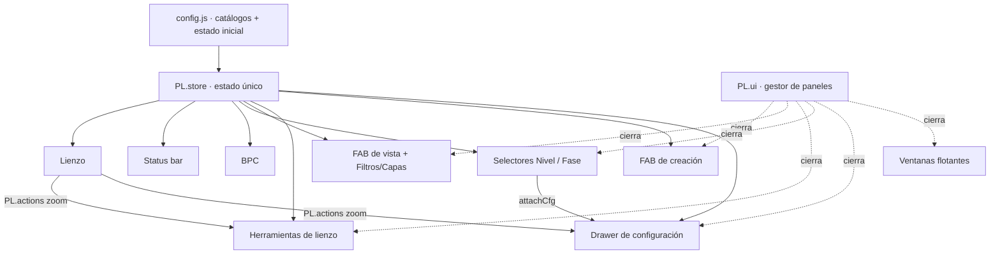
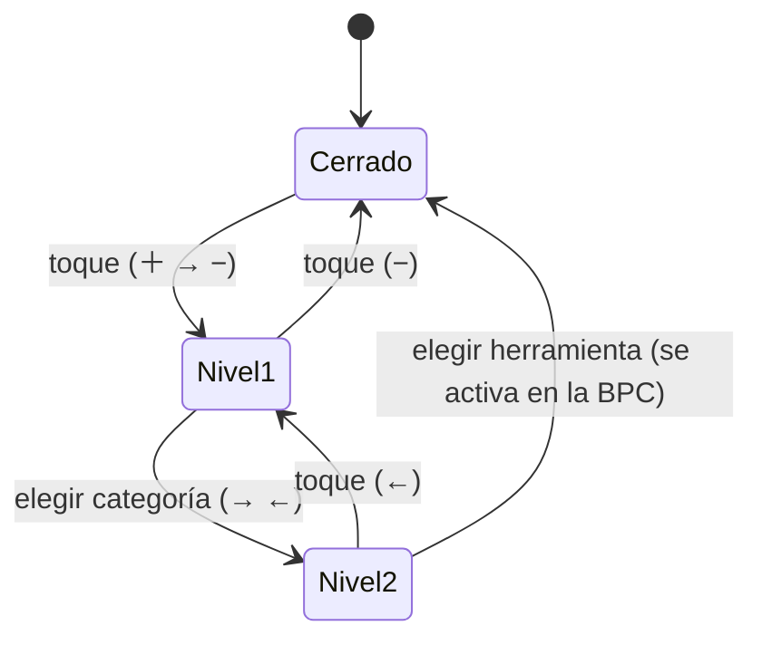

# PolyLive · Mockup SurveyScreen · Vista Planta

Documentación funcional y técnica del mockup v2.0 (refactorizado). Describe qué hace cada elemento de la pantalla, cómo está construido y qué quedó pendiente.

## 1. Propósito y alcance

Prototipo navegable, sin backend, para validar la interfaz de levantamiento de PolyLive en la **vista de Planta · Arquitectura**. Todo el comportamiento es real en el navegador (estados, restricciones, sincronización), pero los datos son de demostración y no se guardan.

Fuera de alcance por ahora: vista de Altimetría, menú principal (☰), nivel 3 del FAB de creación (formas de creación de cada herramienta), persistencia y conexión BLE real.

## 2. Cómo ejecutarlo

| Acción | Cómo |
|---|---|
| Ver el mockup | Abrir `index.html` o `dist/polylive-planta.html` en el navegador |
| Regenerar el archivo único | `python3 build.py` |
| Correr las pruebas | `npm install && npm test` |

`index.html` carga los scripts con `<script src>` clásicos (no módulos ES), por eso funciona abriéndolo directamente desde el disco.

## 3. Mapa de la pantalla

```
┌──────────────────────────────────────┐
│        (zona segura cámara)          │
│          SUMB · Recinto 03           │  ← Status bar, fila 1
│ ☰                     ↺  ↻  ᛒ  ⋮     │  ← Status bar, fila 2
├──────────────────────────────────────┤
│ ┌──────────────────────────────────┐ │
│ │ Muro seleccionado · Tipo · ↔ Esp │ │  ← BPC (barra contextual)
│ └──────────────────────────────────┘ │
│ Nivel: Nivel 0                   (▦) │  ← chip de nivel · FAB de vista
│                                   ▼  │  ← Filtros
│                                   ▤  │  ← Capas
│ (≡)                                  │
│ (◷)        ┌────────┐                │  ← FABs Nivel / Fase (lateral)
│            │  muros │                │
│            └────────┘                │
│                                      │
│ (🛠)                            (＋) │  ← Herramientas · FAB de creación
└──────────────────────────────────────┘
```

## 4. Arquitectura



Tres ideas sostienen el código:

**Una sola fuente de verdad (`PL.store`).** Todo el estado vive en un objeto (ver sección 6). Los componentes escriben con `set / toggle / mutate` y se repintan suscribiéndose a rutas (`'snap'`, `'niveles.items'`…). Por eso el FAB de herramientas y el drawer siempre muestran lo mismo: leen y escriben las mismas rutas.

**Un gestor de paneles (`PL.ui`).** Cada elemento desplegable se registra con `{isOpen, close}`. Al abrir cualquiera se llama `PL.ui.closeAll(excepciones)`, lo que garantiza la regla "solo un panel abierto a la vez". Claves: `fc`, `fv`, `ct`, `rs:niveles`, `rs:fases`, `cd`, `fw:<ventana>`.

**Menús como datos (`config.js`).** Categorías, herramientas, vistas, filtros, capas, opciones de la esquina, temas y propiedades arrastrables son catálogos. Los componentes los recorren y pintan; agregar una opción no requiere tocar componentes.

### 4.1 Archivos

| Archivo | Responsabilidad |
|---|---|
| `js/core.js` | `PL.el` (DOM declarativo), `PL.store`, `PL.ui`, `PL.FloatWindow`, `PL.toast`, `PL.gestures` (longPress, drag) |
| `js/config.js` | Catálogos y `initialState()` |
| `js/components/canvas.js` | Tema, cuadrícula, zoom (`PL.actions`), visibilidad por filtros/capas, grosor y selección de muros |
| `js/components/statusbar.js` | Título en vivo, botón BLE (toque/mantener) y su ventana |
| `js/components/bpc.js` | Barra de Propiedades Contextual y propiedades por arrastre |
| `js/components/range-selector.js` | Fábrica `PL.RangeSelector` y montaje de Nivel y Fase |
| `js/components/fab-view.js` | FAB de vista, botones y ventanas de Filtros y Capas |
| `js/components/corner-tools.js` | Herramientas de lienzo (Zoom, Snap, Tema, Cuadrícula, Escala) |
| `js/components/fab-create.js` | FAB de creación (máquina de estados de 2 niveles) |
| `js/components/config-drawer.js` | Drawer de configuración (espejo editable del estado) |
| `js/main.js` | Inicializa el store y monta en orden |

Orden de montaje: canvas → statusbar → bpc → selectores → FAB vista → herramientas → FAB creación → drawer. El drawer va al final porque se engancha a las listas de configuración de los selectores.

## 5. Componentes

### 5.1 Status bar

Dos filas bajo una zona segura de 22 px para cámara/notch. Fila 1: sede y recinto centrados, se actualizan si se editan en el drawer. Fila 2: ☰ a la izquierda (menú principal, pendiente) y a la derecha deshacer, rehacer (deshabilitado), Bluetooth y ⋮.

**Bluetooth.** Toque corto enciende o apaga (`ble.on`); encendido se muestra como círculo ámbar. Mantener 0,5 s abre la ventana "Bluetooth (BLE)" con estado, dispositivo, batería y "Buscar dispositivos"; mientras la ventana está abierta el círculo se ve gris y al cerrarla vuelve a ámbar si sigue encendido. Las opciones BLE no están en el drawer del proyecto.

**⋮.** Abre el drawer de configuración y se convierte en ✕ sobre círculo ámbar. No existe otra ✕ dentro del drawer.

### 5.2 Lienzo

Fondo con tema (claro, oscuro, alto contraste) y cuadrícula combinable (líneas, puntos o ambas). El tema solo cambia el lienzo, no la interfaz. La capa `.world` contiene el dibujo y escala con el zoom (25 % a 400 %).

Demo de 4 muros: tocar uno lo selecciona (solo ese se resalta en ámbar); su grosor en pantalla depende de su espesor (1 cm = 0,4 px), así que arrastrar el espesor en la BPC se ve en vivo. Tocar el fondo deselecciona, sale de la herramienta activa y cierra cualquier panel abierto. Si el filtro "Muros" o la capa "Arquitectónico" están apagados, los muros se ocultan.

### 5.3 BPC · Barra de Propiedades Contextual

Barra flotante fija arriba del lienzo, esquinas redondeadas, contenido centrado. Muestra el contexto con esta prioridad:

1. Herramienta activa: "Herramienta: Muro · Arquitectónico · ↔ Espesor 15 cm".
2. Objeto seleccionado: "Muro seleccionado · Tipo: Ladrillo · ↔ Espesor 15 cm".
3. Nada: "Lienzo · vista activa · Escala 1:50 · Zoom 100 %".

Las propiedades numéricas se editan manteniendo el dedo sobre la píldora ↔ y deslizando (un paso cada 6 px). Límites por propiedad en `config.PROPS`. También responde a las flechas del teclado.

### 5.4 Chip de nivel

Texto sutil sin marco bajo la BPC, a la izquierda: "Nivel: Nivel 0". Sigue al deslizador central del selector de nivel.

### 5.5 FAB de vista y Filtros / Capas

Botón ▦ anclado arriba a la derecha (41 px, blanco con borde ámbar). Al tocarlo despliega hacia abajo Estructural, Arquitectura, Topografía y Coordinación; selección tipo radio. Debajo hay dos botones (Filtros ▼ y Capas ▤) que se ocultan mientras el FAB está desplegado. Cada uno abre una ventana flotante con casillas independientes.

### 5.6 Herramientas de lienzo

Botón madre 🛠 abajo a la izquierda. Al tocarlo muestra "−" y despliega hacia arriba cinco filas alineadas con su eje central: Zoom, Snap, Tema, Cuadrícula y Escala. Cada fila abre su menú horizontal hacia la derecha, sin textos; solo una fila abierta a la vez.

| Fila | Opciones | Tipo |
|---|---|---|
| Zoom | encuadre, acercar, alejar, a selección | acciones (sin estado encendido) |
| Snap | nodo, vértice, punto medio, ángulo | toggles múltiples; el icono se pinta ámbar si hay alguno activo |
| Tema | claro, oscuro, alto contraste | radio |
| Cuadrícula | líneas, puntos, rotación | toggles |
| Escala | acotado, anotativa, valor 1:N | toggles + campo |

### 5.7 FAB de creación

Botón principal ámbar abajo a la derecha, anclado: nunca se mueve al desplegar.



Categorías: Acotado (Cota, Texto, Etiqueta), Dibujo (Coordenada, Línea, Polígono), Arquitectónico (Muro, Columna, Suelo), Estructural (Columna, Viga), Auditoría (Foto).

### 5.8 Selectores de rango: Nivel y Fase

Ambos salen de la misma fábrica (`PL.RangeSelector`); Nivel es espacial (cota en metros) y Fase es temporal (orden, sin unidad). Sus FABs de 34 px están apilados y centrados en el lateral izquierdo. Al abrir cualquiera, desaparecen los dos FABs y queda solo el panel.

Panel (28 px de ancho, 62 % del alto del lienzo):

- Botones S, N, I arriba: toggles independientes que habilitan el arrastre de su deslizador (pueden estar varios activos). N activo por defecto.
- Barra con ∞ en ambos extremos y tres deslizadores. El central (N) siempre es ámbar; S e I son grises, se agrandan al activarse y se atenúan si no.
- Restricciones: inferior < central < superior, nunca se superponen, y el central no puede ocupar los extremos.
- Orientación: valores positivos arriba, negativos abajo.
- Tooltip de cada deslizador: nombre y valor, por ejemplo "Nivel 1 (+1 m)".
- ⚙ abre la ventana de configuración sin cerrar el panel; ← (ámbar) cierra el panel y su ventana y vuelve a mostrar los FABs.

Configuración (ventana flotante y sección del drawer, sincronizadas):

- Siempre existen −∞, la base (valor 0) y +∞. Por defecto solo aparece la base en la lista.
- "Agregar" crea un elemento con valor único (máximo + 1). La lista se muestra de mayor a menor.
- Cambiar el valor reordena automáticamente. Si el valor ya existe, aparece un aviso y no se aplica.
- La base puede renombrarse pero no cambia de valor ni se elimina.
- Al reordenar, cada deslizador conserva el elemento que tenía mientras siga siendo válido.

### 5.9 Drawer de configuración

Panel derecho (85 % del ancho) que empieza bajo la status bar, con overlay oscuro; tocar el overlay cierra. Secciones en acordeón: Datos del archivo, Información del proyecto (abierta por defecto), Vista y capas, Zoom, Snap, Tema del lienzo, Cuadrícula, Escala, Selector de nivel y Selector de fase. Todos los controles escriben en el store, por lo que cualquier cambio se refleja al instante en los FABs, el lienzo y la BPC.

### 5.10 Ventanas flotantes y avisos

`PL.FloatWindow` crea ventanas con cabecera y ✕, registradas en `PL.ui` como `fw:<id>`: `ble`, `filtros`, `capas`, `nivelescfg`, `fasescfg`. `PL.toast` muestra avisos breves de 1,8 s en lugar de `alert()`.

## 6. Mapa de estado

| Ruta | Tipo | Escriben | Leen |
|---|---|---|---|
| `proyecto.{sede,recinto,responsable}` | texto | drawer | status bar, drawer |
| `muros[i].{material,props.espesor}` | objeto | BPC | lienzo, BPC |
| `seleccion` | `{tipo, ref}` o null | lienzo, FAB creación | lienzo, BPC |
| `herramienta` | `{id,label,categoria,props}` o null | FAB creación, lienzo | BPC |
| `vista` | id | FAB vista, drawer | FAB vista, BPC, drawer |
| `filtros.*`, `capas.*` | booleanos | ventanas, drawer | lienzo, drawer |
| `zoom` | número | acciones de zoom | lienzo, BPC, drawer |
| `snap.*` | booleanos | herramientas, drawer | herramientas, drawer |
| `tema` | `claro·oscuro·contraste` | herramientas, drawer | lienzo |
| `cuadricula.{lineas,puntos,rotacion}` | booleanos | herramientas, drawer | lienzo |
| `escala.{acotado,anotativa,valor}` | bool/texto | herramientas, drawer | BPC, drawer |
| `ble.{on,dispositivo,bateria}` | mixto | status bar | status bar |
| `niveles`, `fases` | `{items,pos,activos,seq}` | selector de rango | selector, chip, drawer |

## 7. Reglas globales de interacción

1. Solo un panel desplegable abierto a la vez (FABs, selectores, drawer, ventanas).
2. Excepción: la ventana de configuración de Nivel o Fase mantiene abierto su propio panel.
3. Los botones principales de los FABs están anclados; lo que se despliega nunca los desplaza.
4. Estado encendido: círculo o fondo ámbar. Acciones sin estado (zoom) nunca quedan encendidas.
5. Tocar el fondo del lienzo cierra todo y vuelve al contexto "Lienzo".

## 8. Cambios de esta versión (v2.0)

Refactorización:

- Estado central único en lugar de variables sueltas por componente; drawer, FABs y lienzo quedan sincronizados en ambos sentidos.
- Gestor de paneles genérico en lugar de una función `closeAllFabs` con casos particulares.
- Nivel y Fase generados por una sola fábrica; también construye su FAB, panel y ventana.
- Menús declarados como catálogos; los componentes construyen el DOM a partir de ellos.
- Scripts cargados al final del documento: elimina la clase de error que dejó sin funcionar los selectores (código que corría antes de que existiera su HTML).

Ajuste de temas del lienzo (para exteriores):

- **Oscuro**: pensado para interiores o de noche, brillo bajo (`#121212`) sin deslumbrar.
- **Alto contraste**: pensado para trabajar bajo sol directo. Evita grises intermedios (lo primero que el sol "lava"): fondo blanco puro, tinta negra al máximo grosor (`--cv-line-w:2px`), cuadrícula en azul saturado (se mantiene visible aunque el negro se vea algo lavado) y color de selección en magenta (nunca se confunde con el ámbar de la marca ni con el azul de la cuadrícula). Los puntos de la rejilla también se agrandan en este tema.
- Ambos se activan desde el mismo lugar de siempre: FAB de herramientas (esquina inferior izquierda) → fila **Tema** (◐) → ☀ Claro / ☾ Oscuro / ◧ Alto contraste, o desde la sección "Tema del lienzo" del drawer.

Correcciones:

- El drawer tapaba el botón ⋮/✕; ahora empieza bajo la status bar.
- La ventana BLE quedaba encima de la status bar; se reubicó.
- La ventana de configuración de Nivel/Fase tapaba tooltips del panel; ahora aparece a la derecha.
- Al agregar un nivel podía generarse un valor repetido; ahora siempre es único.
- Al reordenar niveles los deslizadores volvían a los extremos; ahora conservan su elemento.
- Arrastrar ya no selecciona texto.

Funciones que antes eran solo visuales y ahora operan: tema y cuadrícula del lienzo, zoom, casillas de Filtros y Capas, arrastre de propiedades en la BPC (con efecto en el dibujo), BPC contextual (lienzo / objeto / herramienta), edición de sede y recinto, selección individual de muros, accesibilidad básica (roles ARIA, foco visible, flechas en la BPC).

## 9. Pendientes

- Nivel 3 del FAB de creación: formas de creación de cada herramienta (Muro, Columna, Suelo, Viga, Cota, Texto, Etiqueta, Coordenada, Línea, Polígono, Foto).
- Contexto de la BPC para cada herramienta de nivel 3.
- Menú principal (☰, drawer izquierdo).
- Vista de Altimetría.
- Comportamiento real de la rotación del lienzo, el zoom a selección y la escala anotativa.
- Contenido de las vistas Estructural, Topografía y Coordinación (hoy solo cambia el estado).
- Decidir si el chip del lienzo también debe mostrar la fase actual.

## 10. Pruebas

`tests/smoke.test.js` carga el archivo único en jsdom y simula toques sobre todos los flujos: status bar y BLE (toque y mantener), drawer (apertura, ✕, edición en vivo), FAB de creación (niveles y retroceso), exclusividad entre paneles, FAB de vista y Filtros/Capas, herramientas de esquina (menús, tema, cuadrícula, zoom, snap, escala), selectores de Nivel y Fase (restricciones, orden, duplicados, sincronía con el drawer, independencia entre ambos) y selección/arrastre en el lienzo.
